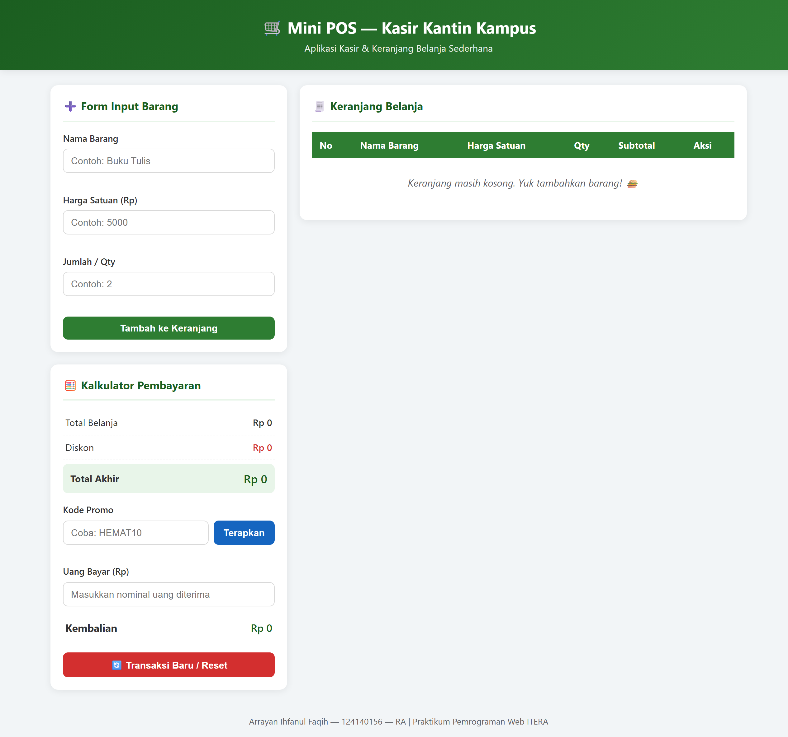
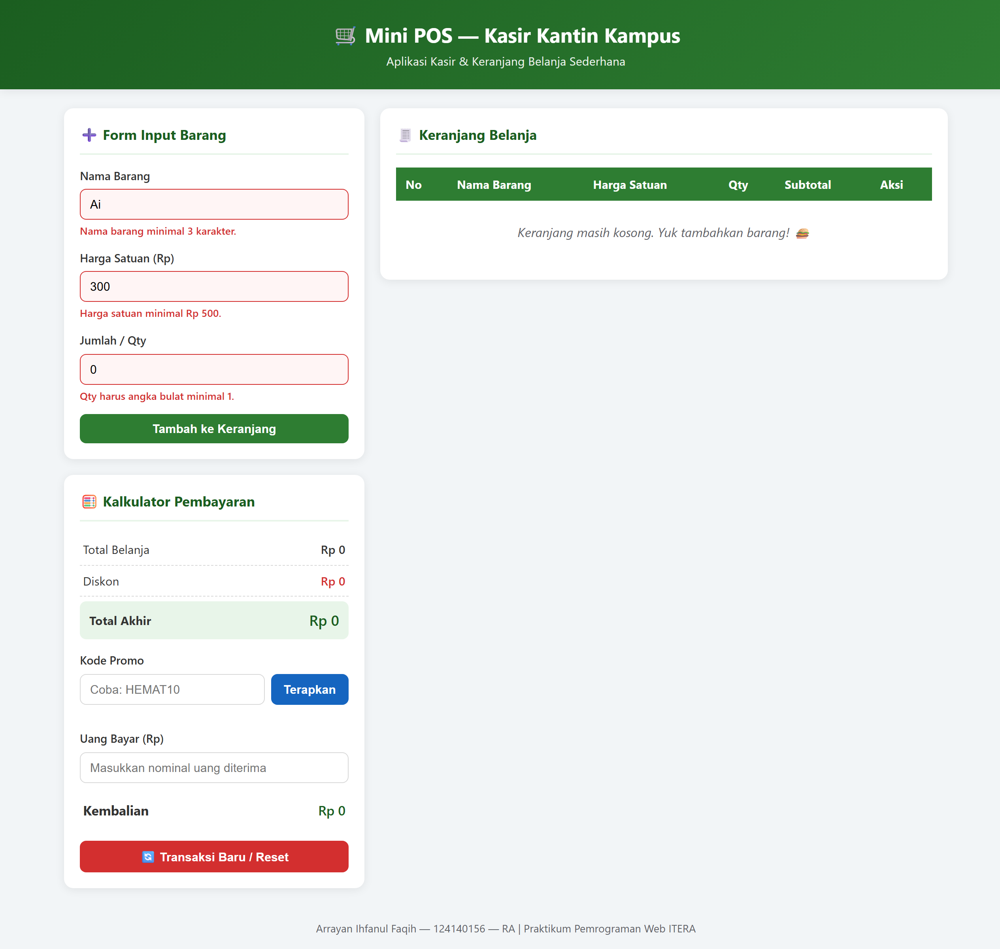
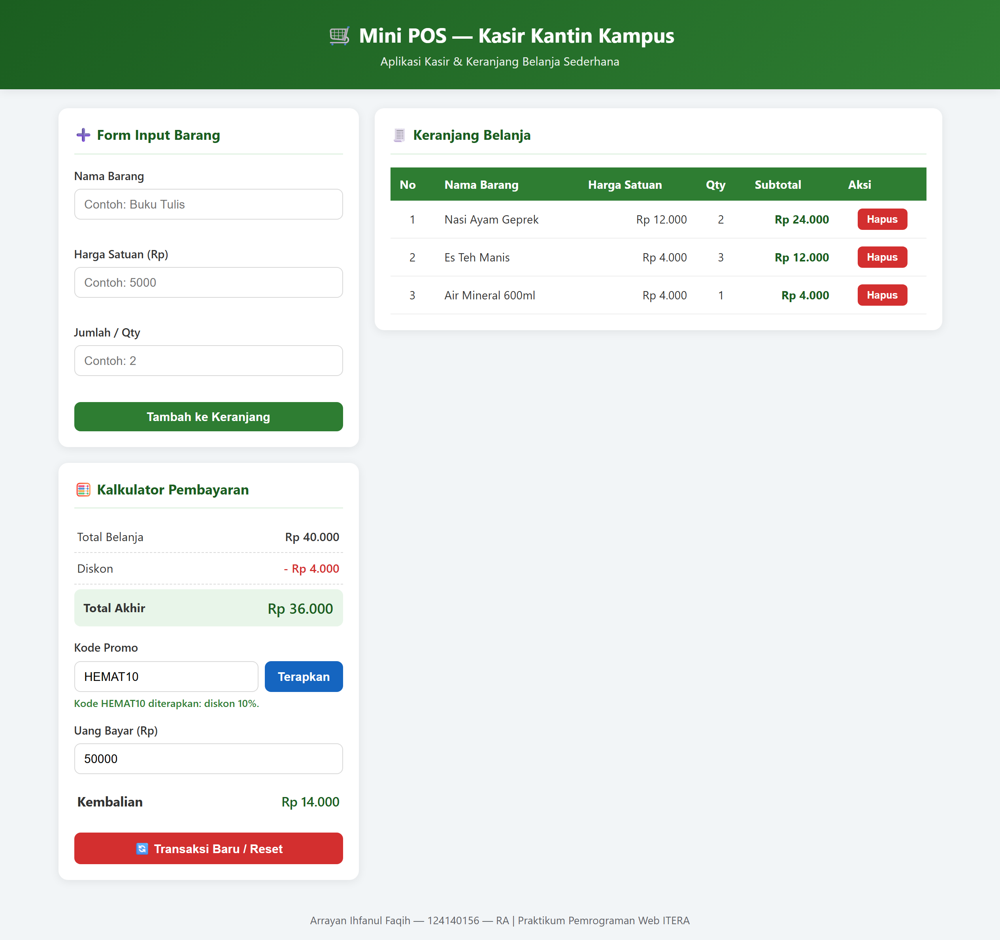

# 🛒 Mini POS — Aplikasi Kasir & Keranjang Belanja Sederhana

Tugas Praktikum Pemrograman Web — Pertemuan 1
Studi kasus: **Kasir kantin / toko kampus**

---

## 👤 Identitas

| | |
|---|---|
| **Nama** | Arrayan Ihfanul Faqih |
| **NIM** | 124140156 |
| **Kelas Praktikum** | RA |

---

## 📱 Deskripsi Aplikasi

**Mini POS** adalah aplikasi web sederhana untuk kasir kantin atau toko kampus. Kasir dapat memasukkan barang satu per satu ke keranjang, lalu aplikasi otomatis menghitung subtotal per barang, total belanja, diskon, total akhir, serta kembalian dari uang yang dibayarkan.

**Tujuan pembuatan:**
- Memenuhi tugas praktikum Pertemuan 1 mata kuliah Pemrograman Web ITERA.
- Menyatukan tiga kompetensi dasar praktikum dalam satu aplikasi:
  1. **Validasi input form** — nama, harga, dan qty barang diperiksa sebelum masuk keranjang.
  2. **Kalkulator otomatis** — subtotal, total, diskon, dan kembalian dihitung real-time.
  3. **Manajemen keranjang + localStorage** — daftar belanja tetap ada walau halaman di-refresh.

---

## ▶️ Panduan Menjalankan

1. **Download / clone** repository ini:
   ```bash
   git clone https://github.com/Rayann956/pemrograman_web_itera_124140156.git
   ```
2. **Buka folder** `arrayanihfanulfaqih_124140156_pertemuan1/`.
3. **Cara cepat**: klik dua kali file `index.html` — aplikasi langsung terbuka di browser.
4. **Cara disarankan (Live Server)**:
   - Buka folder proyek di **VS Code**.
   - Install ekstensi **Live Server** (jika belum ada).
   - Klik kanan `index.html` → **Open with Live Server**.
5. Aplikasi terbuka di browser (Chrome/Firefox/Edge).

> Tidak perlu server backend atau install apapun — semuanya berjalan di browser.

---

## ✅ Daftar Fitur

### 1. Validasi Form Input Barang
- [x] Nama barang **wajib diisi**, minimal **3 karakter**.
- [x] Harga satuan wajib **angka positif**, minimal **Rp 500** (tidak boleh 0, negatif, atau kosong).
- [x] Qty wajib **angka bulat minimal 1**.
- [x] Pesan peringatan **merah di bawah input yang salah** + input diberi border merah.
- [x] Barang **tidak masuk keranjang** jika data tidak valid.
- [x] Form **otomatis di-reset** saat berhasil tambah barang.

### 2. Modul Kalkulator & Perhitungan Otomatis
- [x] **Subtotal per baris** = Harga Satuan × Qty.
- [x] **Total belanja** = penjumlahan seluruh subtotal, dihitung otomatis.
- [x] **Diskon otomatis 10%** jika total belanja ≥ **Rp 50.000**.
- [x] **Kode promo `HEMAT10`** → diskon 10% (diambil nominal diskon terbesar, tidak dijumlahkan).
- [x] **Total akhir** = Total Belanja − Diskon.
- [x] **Kembalian otomatis** = Uang Bayar − Total Akhir.
- [x] Jika uang kurang → muncul keterangan **"Uang belum mencukupi!"** beserta kekurangannya.

### 3. Manajemen List Keranjang & LocalStorage
- [x] Tabel keranjang (No, Nama Barang, Harga Satuan, Qty, Subtotal, Aksi).
- [x] Barang yang ditambahkan **langsung tampil** di tabel.
- [x] Tombol **Hapus** per baris; total & diskon **terhitung ulang otomatis**.
- [x] **Penyimpanan persisten** dengan `localStorage` (`JSON.stringify` saat simpan, `JSON.parse` saat muat).
- [x] Isi keranjang **tidak hilang saat halaman di-refresh**.
- [x] Tombol **Transaksi Baru / Reset** → kosongkan keranjang + bersihkan localStorage (dengan konfirmasi).

### 4. Lain-lain
- [x] Format Rupiah otomatis (`Intl.NumberFormat`).
- [x] Tampilan responsif (layar HP & desktop).
- [x] Kode terstruktur (HTML/CSS/JS terpisah) dengan nama fungsi deskriptif.

---

## 🖼️ Tangkapan Layar

Screenshot diambil dari aplikasi yang berjalan di browser (Chrome).

### 1. Tampilan Form Input Utama
Form input barang + kalkulator pembayaran + tabel keranjang dalam keadaan kosong.



### 2. Tampilan Validasi Error
Pesan peringatan merah muncul di bawah setiap input yang salah (nama < 3 karakter, harga < Rp 500, qty 0) — barang tidak masuk keranjang.



### 3. Tabel Keranjang + Hasil Kalkulator
Keranjang berisi 3 barang, promo `HEMAT10` diterapkan (diskon Rp 4.000), total akhir Rp 36.000, dan kembalian dihitung otomatis dari uang bayar Rp 50.000.



---

## 🔍 Penjelasan Teknis Singkat

### Alur logika JavaScript utama

```
init()
 ├─ muatStorage() ── JSON.parse(localStorage) -> keranjang
 ├─ renderTabel() ── bangun <tr> dari array keranjang
 ├─ hitungSemua() ── total, diskon, total akhir, kembalian
 └─ pasang event listener (submit, klik hapus, promo, uang bayar, reset)
```

**1. Penanganan validasi input** — `validasiInput()`
- Form memakai atribut `novalidate` agar pesan error **custom** yang tampil, bukan bawaan browser.
- Nama: `trim()` lalu cek kosong / `length < 3`.
- Harga: `Number()` lalu cek `NaN`, `<= 0`, dan `< 500`.
- Qty: cek `Number.isInteger()` dan `>= 1`.
- Fungsi `setError(input, elemen, pesan)` menampilkan teks merah di bawah input yang salah dan menambah class `input-error` (border merah). Barang **tidak akan masuk keranjang** jika ada satu saja input yang tidak valid.

**2. Algoritma kalkulator keuangan** — `hitungSemua()`
- `hitungSubtotal(item)` → `harga × qty`.
- `hitungTotal()` → `reduce()` menjumlahkan semua subtotal.
- `hitungDiskon(total)` → diskon otomatis 10% jika `total ≥ 50.000`; atau promo `HEMAT10` → 10%; diambil **nominal terbesar** dari keduanya.
- `totalAkhir = total − diskon`.
- `hitungKembalian(totalAkhir)` → `uangBayar − totalAkhir`; jika negatif, tampilkan "Uang belum mencukupi!" + nominal kekurangan.
- Semua nilai ditampilkan dalam format Rupiah via `Intl.NumberFormat('id-ID')`.

**3. Mekanisme serialisasi localStorage** — `simpanStorage()` / `muatStorage()`
- Setiap kali keranjang berubah (tambah/hapus/reset), `simpanStorage()` menjalankan
  `localStorage.setItem("miniPosKeranjang", JSON.stringify(keranjang))`.
- Saat halaman dibuka, `muatStorage()` menjalankan `JSON.parse(localStorage.getItem(...))`,
  dilengkapi `try-catch` dan pengecekan bentuk data (harus array dengan properti `nama`, `harga`, `qty`) agar aplikasi tidak crash jika data di storage rusak.
- Tombol **Transaksi Baru** menjalankan `localStorage.removeItem()` untuk membersihkan storage.

---

## 📁 Struktur Folder

```
arrayanihfanulfaqih_124140156_pertemuan1/
├── index.html      # Struktur halaman aplikasi
├── style.css       # Styling antarmuka + responsif
├── script.js       # Logika validasi, kalkulator, localStorage
├── README.md       # Dokumentasi tugas
├── screenshots/    # 3 screenshot aplikasi (form, validasi error, kalkulator+tabel)
├── scripts/        # Script pembantu (pengambilan screenshot otomatis via Chrome headless)
├── test/           # Tes logika otomatis (26 assertions)
└── modul/          # File latihan praktikum
```

---

## 🔗 Repository

https://github.com/Rayann956/pemrograman_web_itera_124140156
